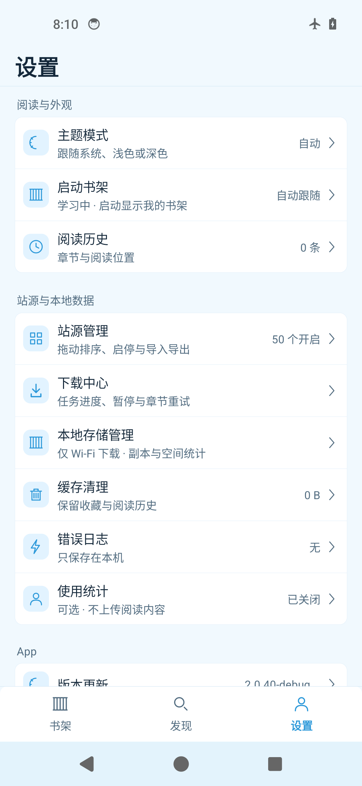
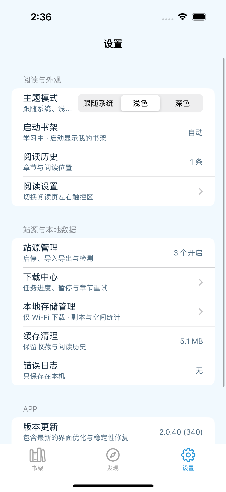

# iOS 与 Android 2.0.40 当前差异核对

最新第五轮e29824a完整范围CI在Debug SDK编译失败：SettingsViewController的leastNormalMagnitude类型歧义；Release、核心、两设备原生/UI均未运行，不能继承第四轮结果为该版本通过。已显式改为CGFloat，并补失败PNG/逐用例JSON上传路径，接下来重跑完整Apple自验。package_ipa仍为false，不生成IPA；非站源及真实51源完整门槛仍未通过。 [第五轮实际记录](../ios-parity-2.0.40/review-evidence/2026-10-11-apple-ci/repair-5-summary.json)。下文历史结果仅对应各自提交。

更新：2026-10-11。固定Android 2.0.40/340、696e80a44ab36b19de6f630565df32978e55a19e；iOS最新已运行9b1d4a2，完整UI仍失败；当前补标准书架导航、批量恢复/取消/重试与同步反馈。先写[阶段开发与自主验收方案](../IOS_2_0_40_PHASED_DEVELOPMENT.md)，再实施以下修正。**尚未完整1:1，P0~P4均未完成全部原生/视觉验收，非站源门槛未通过。**

用户只负责最后总验收；必需的外部条件在[USER_ITEMS](../ios-parity-2.0.40/USER_ITEMS.md)集中汇总。仅sermisellek2-spec/xx-comic-ios用于上传开发验证和打包，不发布Release，不用旧仓库。真实网站仍全部后置。

## 当前目录与产品范围

当前51源=22专用+29 available公共源，默认开启50、duya关闭。公共原JSON有30条，但haoman不可用不进入当前目录。baozimh/mhua5只兼容旧身份与离线记录，不能作为新源重新启用。原52目录、错误manhuawu退役ID及默认顺序已修正，名称/顺序/开关用冻结Git对象再次核对通过。详见[sources.csv](../ios-parity-2.0.40/sources.csv)与[当前目录证据](../ios-parity-2.0.40/review-evidence/2026-10-11-staged-development/source-catalog-proof.json)。生产注册完整名称与HiperDEX配置2项iPhone原生测试通过，数量通过不能证明站点可用。

用户明确淘汰左右手。冻结Android日漫卡片仍存在，但映射同一左右手反向偏好；按用户当前口径删除关联入口和旧偏好消费，不能声称Android冻结代码自身不存在。其他功能不能因难做删除。Files授权、更新浏览器/用户签名工具、iOS后台调度只允许同一用户结果的机制差异。

## 已实施差异与原生待验收边界

| 差异 | 本批实际改动 | 已运行证据 / 剩余验证 |
| --- | --- | --- |
| D18 图标 | 18规格及编译设置，按冻结#4AAEFB合成不透明RGB | 静态尺寸/模式/哈希通过；当前新IPA/主屏未取得。旧包缺资源和半透明是两个问题，不能推断因果 |
| D19 当前源与D30配置 | 当前51/默认50；HiperDEX注册读取导入配置、补冻结默认路由和筛选；导入整体验证，拒绝未来版本/非法URL，报告未知/退役/不支持字段 | 目录静态、配置/导入及隔离协议核心通过；所有适配器字段消费者仍需审计，注册2项Apple已通过，配置全UI待验收 |
| D20 全站搜索 | 使用全部启用且可搜索的源，发现空组/小组不限制全站 | 核心回归通过；两项范围UI在两设备通过；完整搜索取消/排序及空结果源tab仍待验收 |
| D21 下载目录/关闭/反馈竞争 | 按需准备目录、空态重试、取消与弹出关闭；详情/下载反馈独立，阅读/下载互相使旧任务失效 | 目录6项、独立反馈状态6项通过；迟到详情反馈UI两设备通过；其余下载目录相关UI实际失败，继续定位修复 |
| D22 封面 | rem_no_image加载/空/失败，成功恢复布局；合集首卷封面 | 三项iPhone封面图像测试通过，完整状态/尺寸UI待验收，不把有效测试封面当作故障 |
| D23 书架信息/锚点 | 真实阅读章与目录修订计算未读/最新章；首次修订通知；作品ID/相对偏移恢复刷新、列表切换、旋转位置 | 核心状态/追更通过；完整收藏撤销和长列表UI/尺寸待验收。长按仍是单本管理 |
| D24 整本删除撤销 | 页面独立3.5秒撤销，进程等待期退出保留副本；实际删除等待下载停止，预检稳定ID、精确路径、未知文件/外链；真实成功后清对应分组，保留在线收藏/历史 | 撤销、真实文件、持久删除及活动工作者核心通过；原生整本撤销/错误/恢复仍待验收 |
| D25 下载位置消费者 | Files书签/重授权/旧位置映射；同步协调目录、发布、校验/读取、统计/删除；异步私有暂存后跨卷原子发布；离线图像组件接入下载记录读取器，校验移后台；权限失败保留重授权提示 | 新增10项文件提供器/重新下载回归，全部下载相关49项通过；Linux注入权限/协调接口，不能证明Apple Files持续授权；OfflineDownloadImageTests iPhone真实解码通过；真实Files重启/撤权仍未验收 |
| D33 完成章节操作 | 补冻结已有长按删除/重新下载及确认，精确清理后同身份/旧目录再入队；阅读按钮启用且命中44pt | 损坏章真实重下载/未知原文件保护/存储失败回滚通过；原生菜单与重新下载后阅读实际像素用例未运行 |
| D26 缓存/空间线程与假成功 | URLCache actor真实统计清理，等待WebKit；清图片/增强缓存并让迟到写入失效；空间后台统计，真实错误/取消/重试 | 五项缓存核心通过；当前UI及Files失权/磁盘失败/性能待验收，不清下载/原包 |
| D27 导航/设置/书架/发现 | 左标题20pt粗体、冻结底栏图标与文字/细线；设置11项、28pt图标块、完整主题面板；书架双标题24/16pt取代额外分段栏；真实悬浮导入；发现12pt指势收放及位置恢复 | 设置/书架/发现及同状态设置截图用例已接线；双方设置8参考已取得；全局标题按钮仍失败，当前标准导航修复待Apple；设置间距/对齐及全应用视觉仍待验收 |
| D28 阅读条 | 总88pt=42/46两行；第二行图标+文字/明确命中高度；控制条上一/下一直接切章，与单页手势独立，实际禁用态；目录遮罩可关闭 | 源码语法通过；两设备单页按章操作/目录关闭UI各2项通过。不得据此关闭完整阅读手势/位置/AI要求 |
| D29 详情层级 | 冻结实际全宽190/220/250封面、下面圆角信息区、20pt标题及内联下载/源、元信息/标签/简介、底部收藏44与阅读62 | 原生长标题/缺元数据/横屏/主题、换源与读取闭环待验收；不再把冻结布局误写成并排封面 |
| D31 淘汰功能 / D32 更新 | 忽略旧左右手偏好和说明；仅指定iOS仓库HTTPS Releases/IPA，APK/旧仓库回退iOS Releases；失败可重试及浏览器查看 | 更新策略两项核心通过；UI及新包待验收 |
| 可选使用统计 | 原五字段/默认开启/北京时间每日一次/15分钟失败重试/关闭取消/损坏记录保留，前后台真实消费者；UI测试不向生产发送 | 六项隔离上报及四项既有核心通过，真实隔离POST和不跟随重定向；Apple前后台/持久化待验收 |

## 仍需完成的开发和门槛

共同fixture尚未覆盖所有页面，两端同逻辑内容宽度/同状态8场景叠图和逐组件差分缺失；只有设置参考完整元数据，不能计算全应用视觉对齐率。文件型站源在冻结source包中没有实现，只有可选协议/条件分支；按当前51源不新增该不可达入口，详见SOURCE_FILE_SCOPE。逐章取消/删除本批亦已改为等待工作者、真实落盘与失败重试，原生UI待验收。新确认LOCAL04批量恢复按钮误走新建会话、LOCAL07关联文件夹全量复制缺直接索引/重授权、LOCAL08同步/解除失败假成功与书签落盘回滚，见[入口审计](../ios-parity-2.0.40/entry-consumer-audit.md)。这些是真实待实现项，继续自主修复。全部导入/阅读/恢复/后台/弱网/峰值性能仍需当前页面完整验收。

最新9b1d4a2已实际通过Debug/Release Apple SDK构建、核心847项及两设备原生各19项；完整UI各49执行/51条失败，不能记阶段通过。当前修导航/批量恢复/同步反馈，Linux全量846项执行/2个Apple PDF跳过/0失败，66源码仅语法通过；新修复待Apple复验，Files/性能/完整视觉和新IPA仍未完成。见[Apple记录](../ios-parity-2.0.40/review-evidence/2026-10-11-apple-ci/README.md)。阶段未通过，不进入真实网站。

## 真实参考图与实际验证

以下Android来自本批冻结源码独立构建及专用模拟器；iOS仍为a5aeec9旧CI图，**不是当前改动的视觉验收或同宽像素比较**。

| Android当前冻结参考 | iOS旧版本参考 |
| --- | --- |
|  |  |

Android设置8场景的APK/尺寸/字体/旋转/主题/步骤/哈希/UI边界见[原始manifest](../ios-parity-2.0.40/review-evidence/2026-10-11-staged-development/android-settings-matrix/android-settings-manifest.json)。平板模拟器尺寸覆盖不是实体平板证据；系统任务栏/留白没有遮掉。iOS已新增空库/51源/关闭统计同状态设置参考用例，两设备8参考已运行，按EXIF显示方向核验正确；缓存状态不同，仍不算同内容像素验收。此前原图和旧对照说明保留于historical-assessment-before-staged-development.md。

| 当前实际检查 | 结果 | 证据边界 |
| --- | --- | --- |
| 固定基线及目录审计 | 527文件/ZIP及51/默认50，退出0 | 冻结来源和元数据，不证明网站可用 |
| Android独立参考构建 | testDebugUnitTest assembleDebug退出0；702测试、2跳过、0失败/错误 | 不修改Android产品工作树；模拟器设置参考使用此APK |
| 前批Linux ComicCore | 838执行、2个Apple PDF跳过、0失败/133.842秒 | 792b599前批输入，不能覆盖后续修复 |
| c6363d7 Apple核心 | 846执行、0失败/80.435秒 | 原生PDF分支包含在该快照；不证明Files持续授权 |
| 独立详情反馈状态 | 6项、0失败，退出0 | 相同源文件与单测临时Package，不运行UIKit |
| 当前原生/测试Swift语法 | 66文件，Release及DEBUG退出0 | 仅语法，非Apple SDK类型检查或运行 |
| c6363d7 Apple SDK/原生 | Debug/Release构建成功；iPhone18项0失败 | 注册2/封面3/反馈6/离线解码1/增强6；CoreML为实际neural输出 |
| 9b1d4a2 Apple/UI | 两设备原生各19通过；UI各49执行/51条失败，设置8参考取得，新IPA无 | 当前新增修复待复验，完整视觉/Files/性能未完成 |

[本轮命令、退出码、失败修复、输入哈希及验证汇总](../ios-parity-2.0.40/review-evidence/2026-10-11-staged-development/README.md)。阶段分别见[P0](../ios-parity-2.0.40/stages/P0.md)、[P1](../ios-parity-2.0.40/stages/P1.md)、[P2](../ios-parity-2.0.40/stages/P2.md)、[P3](../ios-parity-2.0.40/stages/P3.md)、[P4](../ios-parity-2.0.40/stages/P4.md)。

指定仓库[CI38104946234](https://github.com/sermisellek2-spec/xx-comic-ios/actions/runs/38104946234)历史成功，代码a5aeec9，现有未签名IPA 15,953,890字节，2.0.40/340，SHA-256 cb18338e00e8cf9b7bb1dab1a4c639a67936ece8db1541c25b56e29aec5c984d；实际无CFBundleIcons/iPad图标/Assets.car/AppIcon PNG。它不含当前修正，不是本轮交付，安装仍需用户签名。先完成全部非站源自验，再按51源逐一真实验收，最后仅指定仓库产出对应版本总验收包。
